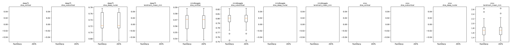

# FastWarp benchmark: recipe `cohort`

Machine and software of the latest `run` (`environment.json`):

- CPU: Intel(R) Core(TM) i7-10700K CPU @ 3.80GHz, 16 logical cores, 8 physical
- GPU: AMD Radeon Pro 5500 XT, DiscreteGpu, Metal, driver name not recorded
- OS: macOS-26.6.2-x86_64-i386-64bit-Mach-O; Python 3.13.18, NumPy 2.3.5, SciPy 1.15.3
- fastwarp 0.2.0 (engine fastwarp-legacy 90c1df3); ANTs v2.5.1.post95-g2236a75 (ANTsPy's bundled antsRegistration); ANTsPy 0.6.3
- benchmark commit 124d690c55aa10dc01f5de26d360f02466992567, recorded 2026-11-17T08:45:11+00:00

Thread setting of each command (all cores unless `--threads` capped both engines; timings with different settings are not comparable, so the tables keep them apart):

- `run`: threads all cores (ANTs and FastWarp's CPU work); 16 logical, 8 physical cores
- `linear`: threads all cores (ANTs and FastWarp's CPU work); 16 logical, 8 physical cores
- `post`: threads all cores (ANTs and FastWarp's CPU work); 16 logical, 8 physical cores

## FastWarp against ANTs, paired over the same pairs

Difference = FastWarp minus ANTs; CI = 95 % percentile bootstrap of the mean difference; p = Wilcoxon signed-rank (pairs share subjects, so the p-values and CIs treat dependent pairs as independent).

| Dataset | Metric | Better | Pairs | FastWarp mean | SD | ANTs mean | SD | Mean diff. | CI low | CI high | p |
| --- | --- | --- | --- | --- | --- | --- | --- | --- | --- | --- | --- |
| deep7t | wall_s | lower | 10 | 8.217 | 0.465 | 393.320 | 56.497 | -385.102 | -419.170 | -352.742 | 0.002 |
| deep7t | jac_nonpositive_frac | lower | 10 | 0.000 | 0.000 | 0.000 | 0.000 | 0.000 | 0.000 | 0.000 | 1.000 |
| deep7t | dice_deep_nuclei | higher | 10 | 0.732 | 0.034 | 0.732 | 0.034 | 4.43e-05 | -9.46e-05 | 2.09e-04 | 1.000 |
| deep7t | hd95_mm_deep_nuclei | lower | 10 | 1.517 | 0.230 | 1.517 | 0.233 | -5.11e-05 | -0.004 | 0.004 | 0.461 |
| deep7t | assd_mm_deep_nuclei | lower | 10 | 0.543 | 0.066 | 0.543 | 0.066 | 1.70e-05 | -6.09e-04 | 4.94e-04 | 0.492 |
| mindboggle | wall_s | lower | 20 | 9.654 | 0.551 | 354.920 | 31.423 | -345.265 | -357.906 | -331.294 | 1.91e-06 |
| mindboggle | dice_cortical | higher | 20 | 0.567 | 0.014 | 0.568 | 0.014 | -4.40e-05 | -2.16e-04 | 1.22e-04 | 0.812 |
| mindboggle | hd95_mm_cortical | lower | 20 | 5.886 | 0.410 | 5.887 | 0.407 | -9.72e-04 | -0.005 | 0.003 | 0.841 |
| mindboggle | assd_mm_cortical | lower | 20 | 1.303 | 0.078 | 1.303 | 0.078 | 1.75e-04 | -2.80e-04 | 6.45e-04 | 0.898 |
| mindboggle | dice_subcortical | higher | 20 | 0.798 | 0.018 | 0.798 | 0.018 | 4.47e-06 | -1.13e-04 | 1.15e-04 | 0.756 |
| mindboggle | hd95_mm_subcortical | lower | 20 | 1.945 | 0.355 | 1.945 | 0.355 | 5.44e-04 | -0.004 | 0.005 | 0.790 |
| mindboggle | assd_mm_subcortical | lower | 20 | 0.725 | 0.076 | 0.724 | 0.075 | 6.74e-05 | -2.15e-04 | 3.16e-04 | 0.349 |
| mindboggle | jac_nonpositive_frac | lower | 20 | 0.000 | 0.000 | 0.000 | 0.000 | 0.000 | 0.000 | 0.000 | 1.000 |
| snsx | wall_s | lower | 20 | 13.314 | 0.227 | 617.634 | 8.014 | -604.320 | -607.810 | -601.161 | 1.91e-06 |
| snsx | jac_nonpositive_frac | lower | 20 | 0.000 | 0.000 | 0.000 | 0.000 | 0.000 | 0.000 | 0.000 | 1.000 |
| snsx | landmark_mean_mm | lower | 20 | 1.746 | 0.368 | 1.747 | 0.365 | -0.002 | -0.010 | 0.008 | 0.177 |
| snsx | landmark_median_mm | lower | 20 | 1.341 | 0.251 | 1.337 | 0.236 | 0.004 | -0.010 | 0.021 | 0.956 |

## Agreement between the two engines

Field differences (mm) inside the fixed brain mask; Dice between the label maps the two engines warp.

| Dataset | Metric | Pairs | Mean | SD | Max |
| --- | --- | --- | --- | --- | --- |
| deep7t | field_diff_rms_mm | 10 | 0.164 | 0.363 | 1.183 |
| deep7t | field_diff_mean_mm | 10 | 0.077 | 0.141 | 0.462 |
| deep7t | field_diff_p95_mm | 10 | 0.275 | 0.565 | 1.840 |
| deep7t | field_diff_max_mm | 10 | 1.965 | 4.324 | 14.121 |
| deep7t | agreement_dice_deep_nuclei | 10 | 0.997 | 0.002 | 0.999 |
| mindboggle | field_diff_rms_mm | 20 | 0.075 | 0.043 | 0.158 |
| mindboggle | field_diff_mean_mm | 20 | 0.039 | 0.020 | 0.075 |
| mindboggle | field_diff_p95_mm | 20 | 0.122 | 0.072 | 0.280 |
| mindboggle | field_diff_max_mm | 20 | 1.483 | 1.109 | 4.355 |
| mindboggle | agreement_dice_cortical | 20 | 0.987 | 0.007 | 0.999 |
| mindboggle | agreement_dice_subcortical | 20 | 0.997 | 0.001 | 1.000 |
| snsx | field_diff_rms_mm | 20 | 0.187 | 0.225 | 0.812 |
| snsx | field_diff_mean_mm | 20 | 0.143 | 0.170 | 0.619 |
| snsx | field_diff_p95_mm | 20 | 0.386 | 0.473 | 1.630 |
| snsx | field_diff_max_mm | 20 | 1.034 | 1.131 | 4.773 |

## Mean Dice per structure (non-cortical)

| Dataset | Label | Structure | FastWarp | ANTs | Pairs |
| --- | --- | --- | --- | --- | --- |
| deep7t | 1 | STN_L | 0.619 | 0.618 | 10 |
| deep7t | 2 | STN_R | 0.636 | 0.636 | 10 |
| deep7t | 3 | SN_L | 0.717 | 0.716 | 10 |
| deep7t | 4 | SN_R | 0.721 | 0.721 | 10 |
| deep7t | 5 | RN_L | 0.828 | 0.828 | 10 |
| deep7t | 6 | RN_R | 0.805 | 0.804 | 10 |
| deep7t | 7 | GPe_L | 0.789 | 0.789 | 10 |
| deep7t | 8 | GPe_R | 0.772 | 0.772 | 10 |
| deep7t | 9 | GPi_L | 0.714 | 0.714 | 10 |
| deep7t | 10 | GPi_R | 0.717 | 0.717 | 10 |
| mindboggle | 10 | Left-Thalamus | 0.875 | 0.875 | 20 |
| mindboggle | 11 | Left-Caudate | 0.796 | 0.796 | 20 |
| mindboggle | 12 | Left-Putamen | 0.870 | 0.870 | 20 |
| mindboggle | 13 | Left-Pallidum | 0.812 | 0.812 | 20 |
| mindboggle | 17 | Left-Hippocampus | 0.765 | 0.765 | 20 |
| mindboggle | 18 | Left-Amygdala | 0.717 | 0.717 | 20 |
| mindboggle | 26 | Left-Accumbens | 0.697 | 0.696 | 20 |
| mindboggle | 28 | Left-VentralDC | 0.840 | 0.840 | 20 |
| mindboggle | 49 | Right-Thalamus | 0.876 | 0.876 | 20 |
| mindboggle | 50 | Right-Caudate | 0.800 | 0.800 | 20 |
| mindboggle | 51 | Right-Putamen | 0.868 | 0.868 | 20 |
| mindboggle | 52 | Right-Pallidum | 0.821 | 0.821 | 20 |
| mindboggle | 53 | Right-Hippocampus | 0.769 | 0.769 | 20 |
| mindboggle | 54 | Right-Amygdala | 0.708 | 0.709 | 20 |
| mindboggle | 58 | Right-Accumbens | 0.708 | 0.707 | 20 |
| mindboggle | 60 | Right-VentralDC | 0.840 | 0.840 | 20 |

## Registration time

Seconds per registration, median (quartiles); `[n=k]`: only k registrations have the value. Linear: the rigid and affine stages; SyN: the SyN stage; total: the engine's own total (FastWarp: opening the GPU, resampling, preprocessing, both stages, warping the moving image onto the grid and writing the transforms; ANTs: `Total elapsed time`, the stages and their set-up without reading the images or writing the transforms), so the totals do not cover the same work; wall: FastWarp's `register_syn` call (images already read), ANTs' whole process (start, reading, writing; with ANTsPy also starting Python). ANTs' split comes from its `--verbose 1` log. ANTs / FastWarp: the median over pairs of the ratio, on the pairs where both engines have the value and ran on the same machine and software.

| Dataset | Grid | Threads | Engine | Registrations | Linear (s) | SyN (s) | Total (s) | Wall (s) |
| --- | --- | --- | --- | --- | --- | --- | --- | --- |
| deep7t | 1 mm | all cores | fastwarp | 10 | 2.7 (2.5–2.8) | 5.1 (5.0–5.3) | 8.1 (7.9–8.6) | 8.2 (8.0–8.6) |
| deep7t | 1 mm | all cores | ants | 10 | 15.7 (14.1–16.8) | 354.2 (343.0–412.9) | 369.2 (356.7–430.8) | 375.8 (362.9–438.0) |
| deep7t | 1 mm | all cores | ANTs / FastWarp |  | 5.8x (10 pairs) | 71.4x (10 pairs) | 46.3x (10 pairs) | 46.9x (10 pairs) |
| mindboggle | 1 mm | all cores | fastwarp | 20 | 3.6 (3.3–3.8) | 5.5 (5.3–5.7) | 9.6 (9.4–9.8) | 9.7 (9.4–9.9) |
| mindboggle | 1 mm | all cores | ants | 20 | 18.7 (17.2–21.2) | 335.0 (318.0–350.2) | 356.1 (337.4–368.6) | 363.4 (344.5–376.3) |
| mindboggle | 1 mm | all cores | ANTs / FastWarp |  | 5.4x (20 pairs) | 60.7x (20 pairs) | 36.3x (20 pairs) | 36.8x (20 pairs) |
| snsx | 1 mm | all cores | fastwarp | 20 | 3.5 (3.3–3.6) | 9.1 (9.1–9.2) | 13.3 (13.1–13.4) | 13.4 (13.2–13.5) |
| snsx | 1 mm | all cores | ants | 20 | 24.4 (22.8–24.8) | 580.8 (577.3–583.9) | 604.8 (600.4–608.5) | 616.9 (612.6–620.6) |
| snsx | 1 mm | all cores | ANTs / FastWarp |  | 6.9x (20 pairs) | 63.7x (20 pairs) | 45.5x (20 pairs) | 46.2x (20 pairs) |

## Linear fits

Seconds per fit, median (quartiles). FastWarp: one `linear_session` per pair; its preparation (opening the GPU, converting, winsorizing and uploading the images, the centre-of-mass start) is its own row and not part of the fits; rigid from the centres of mass, affine from the rigid result, then a rigid multi-start. ANTs: one `antsRegistration` stage time each, which includes the stage's own image preparation; no multi-start. Rigid + affine compares FastWarp's preparation and both fits with ANTs' two stages. Pairs: FastWarp / ANTs. ANTs / FastWarp: the median over pairs of the ratio (same machine and software). Landmark error: mean over the landmarks of a pair, mm; FastWarp - ANTs: mean and max distance between the two fits over the fixed brain mask, mm (the multi-start against ANTs' rigid fit).

| Dataset | Grid | Threads | Fit | Pairs | FastWarp (s) | ANTs (s) | ANTs / FastWarp | Landmarks FastWarp (mm) | Landmarks ANTs (mm) | FastWarp - ANTs mean (mm) | FastWarp - ANTs max (mm) |
| --- | --- | --- | --- | --- | --- | --- | --- | --- | --- | --- | --- |
| snsx | 1 mm | all cores | session preparation | 20 / 0 | 0.28 (0.28–0.29) | n/a | n/a | n/a | n/a | n/a | n/a |
| snsx | 1 mm | all cores | rigid + affine (FastWarp with its preparation) | 20 / 20 | 3.71 (3.58–3.84) | 23.44 (21.81–24.25) | 6.2x (20 pairs) | n/a | n/a | n/a | n/a |
| snsx | 1 mm | all cores | rigid | 20 / 20 | 1.81 (1.72–1.85) | 10.03 (9.44–11.18) | 5.9x (20 pairs) | 13.81 (10.08–17.04) | 13.95 (10.01–17.04) | 1.32 (0.77–2.09) | 2.50 (1.40–3.79) |
| snsx | 1 mm | all cores | affine (from the rigid fit) | 20 / 20 | 1.61 (1.54–1.71) | 12.85 (12.21–13.44) | 7.6x (20 pairs) | 2.93 (2.45–3.51) | 2.94 (2.45–3.41) | 0.13 (0.10–0.26) | 0.31 (0.25–0.56) |
| snsx | 1 mm | all cores | rigid multi-start | 20 / 0 | 4.42 (4.33–4.62) | n/a | n/a | 13.37 (9.95–16.66) | n/a | 4.75 (2.13–9.54) | 7.98 (4.10–19.32) |

## Post-processing

Seconds per step, median (quartiles), each including reading the inputs (read once, untimed, before both tools, so both find them cached) and writing the output; ANTs: `antsApplyTransforms --float 1`. `.nii`: uncompressed output; `.nii.gz`: FastWarp's fields gzip level 1 in parallel, ITK (ANTs' outputs and FastWarp's re-warped image) its default level on one thread. Size: median output MB, FastWarp / ANTs. ANTs / FastWarp: the median over pairs of the ratio. Difference (of the `.nii` outputs): median over pairs of the max field difference (mm) or of the relative RMS difference of the re-warped images.

| Dataset | Grid | Threads | Step | Output | Pairs | Voxels | ANTs (s) | FastWarp (s) | ANTs / FastWarp | Size (MB) | Difference |
| --- | --- | --- | --- | --- | --- | --- | --- | --- | --- | --- | --- |
| deep7t | 1 mm | all cores | forward field (compose) | .nii | 10 | 14.1 M | 0.64 (0.63–0.68) | 0.43 (0.41–0.46) | 1.5x (10 pairs) | 169 / 169 | max 2.62e-05 mm |
| deep7t | 1 mm | all cores | inverse field (compose) | .nii | 10 | 24.0 M | 0.89 (0.88–0.90) | 0.60 (0.59–0.63) | 1.4x (10 pairs) | 288 / 288 | max 3.85e-05 mm |
| deep7t | 1 mm | all cores | Lanczos re-warp | .nii | 10 | 14.1 M | 3.40 (3.33–3.69) | 0.92 (0.88–0.96) | 3.8x (10 pairs) | 56 / 56 | relative RMS 4.49e-06 |
| mindboggle | 1 mm | all cores | forward field (compose) | .nii | 20 | 4.7 M | 0.26 (0.25–0.27) | 0.15 (0.14–0.16) | 1.7x (20 pairs) | 56 / 56 | max 2.13e-05 mm |
| mindboggle | 1 mm | all cores | inverse field (compose) | .nii | 20 | 10.5 M | 0.46 (0.44–0.48) | 0.28 (0.27–0.29) | 1.6x (20 pairs) | 126 / 126 | max 3.15e-05 mm |
| mindboggle | 1 mm | all cores | Lanczos re-warp | .nii | 20 | 4.7 M | 1.25 (1.19–1.32) | 0.33 (0.32–0.36) | 3.6x (20 pairs) | 19 / 19 | relative RMS 1.68e-06 |
| snsx | 1 mm | all cores | forward field (compose) | .nii | 20 | 8.5 M | 0.51 (0.51–0.52) | 0.35 (0.34–0.35) | 1.5x (20 pairs) | 102 / 102 | max 2.68e-05 mm |
| snsx | 1 mm | all cores | inverse field (compose) | .nii | 20 | 26.2 M | 1.16 (1.14–1.18) | 0.78 (0.77–0.79) | 1.5x (20 pairs) | 314 / 314 | max 4.50e-05 mm |
| snsx | 1 mm | all cores | Lanczos re-warp | .nii | 20 | 8.5 M | 2.23 (2.19–2.27) | 0.74 (0.73–0.76) | 3.0x (20 pairs) | 34 / 34 | relative RMS 3.10e-06 |

