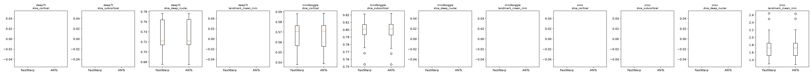

# FastWarp benchmark: recipe `cohort`

Machine and software of the latest `run` (`environment.json`):

- CPU: Apple M5 Pro, 18 logical cores, 18 physical
- GPU: Apple M5 Pro, IntegratedGpu, Metal, driver name not recorded
- OS: macOS-26.5.2-arm64-arm-64bit-Mach-O; Python 3.13.18, NumPy 2.3.5, SciPy 1.15.3
- fastwarp 0.2.0 (engine fastwarp-legacy 90c1df3); ANTs v2.5.1.post95-g2236a75 (ANTsPy's bundled antsRegistration); ANTsPy 0.6.3
- benchmark commit 124d690c55aa10dc01f5de26d360f02466992567, recorded 2026-11-17T08:31:48+00:00

Thread setting of each command (all cores unless `--threads` capped both engines; timings with different settings are not comparable, so the tables keep them apart):

- `run`: threads all cores (ANTs and FastWarp's CPU work); 18 logical, 18 physical cores
- `linear`: threads all cores (ANTs and FastWarp's CPU work); 18 logical, 18 physical cores
- `post`: threads all cores (ANTs and FastWarp's CPU work); 18 logical, 18 physical cores

## FastWarp against ANTs, paired over the same pairs

Difference = FastWarp minus ANTs; CI = 95 % percentile bootstrap of the mean difference; p = Wilcoxon signed-rank (pairs share subjects, so the p-values and CIs treat dependent pairs as independent).

| Dataset | Metric | Better | Pairs | FastWarp mean | SD | ANTs mean | SD | Mean diff. | CI low | CI high | p |
| --- | --- | --- | --- | --- | --- | --- | --- | --- | --- | --- | --- |
| deep7t | wall_s | lower | 10 | 2.565 | 0.152 | 105.807 | 12.910 | -103.242 | -110.321 | -95.389 | 0.002 |
| deep7t | jac_nonpositive_frac | lower | 10 | 0.000 | 0.000 | 0.000 | 0.000 | 0.000 | 0.000 | 0.000 | 1.000 |
| deep7t | dice_deep_nuclei | higher | 10 | 0.732 | 0.034 | 0.732 | 0.034 | -1.25e-04 | -4.30e-04 | 1.31e-04 | 0.770 |
| deep7t | hd95_mm_deep_nuclei | lower | 10 | 1.517 | 0.231 | 1.513 | 0.230 | 0.004 | 0.001 | 0.008 | 0.062 |
| deep7t | assd_mm_deep_nuclei | lower | 10 | 0.543 | 0.065 | 0.542 | 0.065 | 2.78e-04 | -1.48e-04 | 7.33e-04 | 0.557 |
| mindboggle | wall_s | lower | 20 | 2.805 | 0.170 | 90.450 | 7.128 | -87.645 | -90.558 | -84.633 | 1.91e-06 |
| mindboggle | dice_cortical | higher | 20 | 0.567 | 0.014 | 0.568 | 0.014 | -6.58e-05 | -2.77e-04 | 1.56e-04 | 0.674 |
| mindboggle | hd95_mm_cortical | lower | 20 | 5.889 | 0.408 | 5.887 | 0.408 | 0.002 | -0.002 | 0.006 | 0.064 |
| mindboggle | assd_mm_cortical | lower | 20 | 1.303 | 0.078 | 1.303 | 0.078 | 4.86e-04 | -3.84e-04 | 0.001 | 0.294 |
| mindboggle | dice_subcortical | higher | 20 | 0.798 | 0.018 | 0.798 | 0.018 | 1.22e-04 | -5.02e-05 | 2.71e-04 | 0.083 |
| mindboggle | hd95_mm_subcortical | lower | 20 | 1.945 | 0.356 | 1.947 | 0.354 | -0.002 | -0.007 | 0.003 | 0.826 |
| mindboggle | assd_mm_subcortical | lower | 20 | 0.724 | 0.075 | 0.725 | 0.076 | -2.08e-04 | -6.42e-04 | 2.37e-04 | 0.349 |
| mindboggle | jac_nonpositive_frac | lower | 20 | 0.000 | 0.000 | 0.000 | 0.000 | 0.000 | 0.000 | 0.000 | 1.000 |
| snsx | wall_s | lower | 20 | 4.333 | 0.074 | 166.081 | 1.501 | -161.748 | -162.309 | -161.076 | 1.91e-06 |
| snsx | jac_nonpositive_frac | lower | 20 | 0.000 | 0.000 | 0.000 | 0.000 | 0.000 | 0.000 | 0.000 | 1.000 |
| snsx | landmark_mean_mm | lower | 20 | 1.748 | 0.368 | 1.747 | 0.369 | 0.001 | -0.002 | 0.005 | 0.596 |
| snsx | landmark_median_mm | lower | 20 | 1.346 | 0.251 | 1.344 | 0.248 | 0.001 | -0.009 | 0.011 | 0.812 |

## Agreement between the two engines

Field differences (mm) inside the fixed brain mask; Dice between the label maps the two engines warp.

| Dataset | Metric | Pairs | Mean | SD | Max |
| --- | --- | --- | --- | --- | --- |
| deep7t | field_diff_rms_mm | 10 | 0.099 | 0.144 | 0.461 |
| deep7t | field_diff_mean_mm | 10 | 0.063 | 0.090 | 0.295 |
| deep7t | field_diff_p95_mm | 10 | 0.196 | 0.298 | 0.972 |
| deep7t | field_diff_max_mm | 10 | 1.129 | 1.488 | 4.470 |
| deep7t | agreement_dice_deep_nuclei | 10 | 0.997 | 0.003 | 1.000 |
| mindboggle | field_diff_rms_mm | 20 | 0.096 | 0.056 | 0.194 |
| mindboggle | field_diff_mean_mm | 20 | 0.052 | 0.031 | 0.111 |
| mindboggle | field_diff_p95_mm | 20 | 0.173 | 0.106 | 0.400 |
| mindboggle | field_diff_max_mm | 20 | 1.554 | 1.155 | 4.657 |
| mindboggle | agreement_dice_cortical | 20 | 0.983 | 0.010 | 0.999 |
| mindboggle | agreement_dice_subcortical | 20 | 0.997 | 0.002 | 1.000 |
| snsx | field_diff_rms_mm | 20 | 0.150 | 0.141 | 0.595 |
| snsx | field_diff_mean_mm | 20 | 0.116 | 0.108 | 0.449 |
| snsx | field_diff_p95_mm | 20 | 0.303 | 0.295 | 1.257 |
| snsx | field_diff_max_mm | 20 | 0.883 | 0.692 | 2.875 |

## Mean Dice per structure (non-cortical)

| Dataset | Label | Structure | FastWarp | ANTs | Pairs |
| --- | --- | --- | --- | --- | --- |
| deep7t | 1 | STN_L | 0.618 | 0.618 | 10 |
| deep7t | 2 | STN_R | 0.636 | 0.637 | 10 |
| deep7t | 3 | SN_L | 0.717 | 0.717 | 10 |
| deep7t | 4 | SN_R | 0.721 | 0.721 | 10 |
| deep7t | 5 | RN_L | 0.828 | 0.828 | 10 |
| deep7t | 6 | RN_R | 0.804 | 0.805 | 10 |
| deep7t | 7 | GPe_L | 0.789 | 0.789 | 10 |
| deep7t | 8 | GPe_R | 0.772 | 0.772 | 10 |
| deep7t | 9 | GPi_L | 0.714 | 0.714 | 10 |
| deep7t | 10 | GPi_R | 0.717 | 0.717 | 10 |
| mindboggle | 10 | Left-Thalamus | 0.876 | 0.875 | 20 |
| mindboggle | 11 | Left-Caudate | 0.796 | 0.796 | 20 |
| mindboggle | 12 | Left-Putamen | 0.870 | 0.870 | 20 |
| mindboggle | 13 | Left-Pallidum | 0.812 | 0.812 | 20 |
| mindboggle | 17 | Left-Hippocampus | 0.765 | 0.765 | 20 |
| mindboggle | 18 | Left-Amygdala | 0.717 | 0.717 | 20 |
| mindboggle | 26 | Left-Accumbens | 0.697 | 0.696 | 20 |
| mindboggle | 28 | Left-VentralDC | 0.840 | 0.839 | 20 |
| mindboggle | 49 | Right-Thalamus | 0.875 | 0.875 | 20 |
| mindboggle | 50 | Right-Caudate | 0.800 | 0.800 | 20 |
| mindboggle | 51 | Right-Putamen | 0.868 | 0.868 | 20 |
| mindboggle | 52 | Right-Pallidum | 0.821 | 0.821 | 20 |
| mindboggle | 53 | Right-Hippocampus | 0.769 | 0.769 | 20 |
| mindboggle | 54 | Right-Amygdala | 0.708 | 0.709 | 20 |
| mindboggle | 58 | Right-Accumbens | 0.708 | 0.708 | 20 |
| mindboggle | 60 | Right-VentralDC | 0.840 | 0.840 | 20 |

## Registration time

Seconds per registration, median (quartiles); `[n=k]`: only k registrations have the value. Linear: the rigid and affine stages; SyN: the SyN stage; total: the engine's own total (FastWarp: opening the GPU, resampling, preprocessing, both stages, warping the moving image onto the grid and writing the transforms; ANTs: `Total elapsed time`, the stages and their set-up without reading the images or writing the transforms), so the totals do not cover the same work; wall: FastWarp's `register_syn` call (images already read), ANTs' whole process (start, reading, writing; with ANTsPy also starting Python). ANTs' split comes from its `--verbose 1` log. ANTs / FastWarp: the median over pairs of the ratio, on the pairs where both engines have the value and ran on the same machine and software.

| Dataset | Grid | Threads | Engine | Registrations | Linear (s) | SyN (s) | Total (s) | Wall (s) |
| --- | --- | --- | --- | --- | --- | --- | --- | --- |
| deep7t | 1 mm | all cores | fastwarp | 10 | 0.8 (0.8–0.9) | 1.6 (1.6–1.7) | 2.5 (2.5–2.6) | 2.5 (2.5–2.6) |
| deep7t | 1 mm | all cores | ants | 10 | 4.6 (4.3–4.9) | 97.4 (91.7–107.6) | 102.1 (96.2–112.8) | 105.2 (99.2–116.2) |
| deep7t | 1 mm | all cores | ANTs / FastWarp |  | 5.8x (10 pairs) | 60.1x (10 pairs) | 39.9x (10 pairs) | 41.0x (10 pairs) |
| mindboggle | 1 mm | all cores | fastwarp | 20 | 0.9 (0.9–0.9) | 1.8 (1.7–1.8) | 2.8 (2.7–2.9) | 2.9 (2.7–2.9) |
| mindboggle | 1 mm | all cores | ants | 20 | 5.7 (5.2–6.1) | 82.0 (79.4–85.7) | 88.0 (84.8–92.4) | 91.3 (88.0–95.9) |
| mindboggle | 1 mm | all cores | ANTs / FastWarp |  | 6.2x (20 pairs) | 46.2x (20 pairs) | 31.0x (20 pairs) | 32.1x (20 pairs) |
| snsx | 1 mm | all cores | fastwarp | 20 | 1.0 (1.0–1.1) | 3.1 (3.1–3.1) | 4.3 (4.3–4.4) | 4.3 (4.3–4.4) |
| snsx | 1 mm | all cores | ants | 20 | 7.3 (6.9–7.6) | 153.2 (152.8–153.7) | 160.5 (159.9–161.0) | 166.4 (165.8–166.9) |
| snsx | 1 mm | all cores | ANTs / FastWarp |  | 6.8x (20 pairs) | 49.6x (20 pairs) | 37.0x (20 pairs) | 38.3x (20 pairs) |

## Linear fits

Seconds per fit, median (quartiles). FastWarp: one `linear_session` per pair; its preparation (opening the GPU, converting, winsorizing and uploading the images, the centre-of-mass start) is its own row and not part of the fits; rigid from the centres of mass, affine from the rigid result, then a rigid multi-start. ANTs: one `antsRegistration` stage time each, which includes the stage's own image preparation; no multi-start. Rigid + affine compares FastWarp's preparation and both fits with ANTs' two stages. Pairs: FastWarp / ANTs. ANTs / FastWarp: the median over pairs of the ratio (same machine and software). Landmark error: mean over the landmarks of a pair, mm; FastWarp - ANTs: mean and max distance between the two fits over the fixed brain mask, mm (the multi-start against ANTs' rigid fit).

| Dataset | Grid | Threads | Fit | Pairs | FastWarp (s) | ANTs (s) | ANTs / FastWarp | Landmarks FastWarp (mm) | Landmarks ANTs (mm) | FastWarp - ANTs mean (mm) | FastWarp - ANTs max (mm) |
| --- | --- | --- | --- | --- | --- | --- | --- | --- | --- | --- | --- |
| snsx | 1 mm | all cores | session preparation | 20 / 0 | 0.10 (0.09–0.10) | n/a | n/a | n/a | n/a | n/a | n/a |
| snsx | 1 mm | all cores | rigid + affine (FastWarp with its preparation) | 20 / 20 | 1.12 (1.08–1.15) | 7.36 (6.71–7.84) | 6.6x (20 pairs) | n/a | n/a | n/a | n/a |
| snsx | 1 mm | all cores | rigid | 20 / 20 | 0.55 (0.51–0.57) | 3.07 (2.73–3.21) | 5.5x (20 pairs) | 14.12 (10.08–16.57) | 14.47 (11.46–17.04) | 1.26 (0.80–5.73) | 2.22 (1.18–11.02) |
| snsx | 1 mm | all cores | affine (from the rigid fit) | 20 / 20 | 0.47 (0.45–0.49) | 4.29 (3.99–4.58) | 9.2x (20 pairs) | 2.95 (2.46–3.46) | 2.96 (2.47–3.55) | 0.20 (0.12–0.33) | 0.38 (0.24–0.69) |
| snsx | 1 mm | all cores | rigid multi-start | 20 / 0 | 1.31 (1.26–1.37) | n/a | n/a | 12.10 (9.95–16.52) | n/a | 9.67 (1.47–11.97) | 17.27 (3.08–23.90) |

## Post-processing

Seconds per step, median (quartiles), each including reading the inputs (read once, untimed, before both tools, so both find them cached) and writing the output; ANTs: `antsApplyTransforms --float 1`. `.nii`: uncompressed output; `.nii.gz`: FastWarp's fields gzip level 1 in parallel, ITK (ANTs' outputs and FastWarp's re-warped image) its default level on one thread. Size: median output MB, FastWarp / ANTs. ANTs / FastWarp: the median over pairs of the ratio. Difference (of the `.nii` outputs): median over pairs of the max field difference (mm) or of the relative RMS difference of the re-warped images.

| Dataset | Grid | Threads | Step | Output | Pairs | Voxels | ANTs (s) | FastWarp (s) | ANTs / FastWarp | Size (MB) | Difference |
| --- | --- | --- | --- | --- | --- | --- | --- | --- | --- | --- | --- |
| deep7t | 1 mm | all cores | forward field (compose) | .nii | 10 | 14.1 M | 0.18 (0.18–0.19) | 0.14 (0.13–0.15) | 1.3x (10 pairs) | 169 / 169 | max 2.27e-05 mm |
| deep7t | 1 mm | all cores | inverse field (compose) | .nii | 10 | 24.0 M | 0.25 (0.24–0.26) | 0.19 (0.18–0.19) | 1.3x (10 pairs) | 288 / 288 | max 3.45e-05 mm |
| deep7t | 1 mm | all cores | Lanczos re-warp | .nii | 10 | 14.1 M | 1.60 (1.46–1.67) | 0.26 (0.25–0.27) | 6.0x (10 pairs) | 56 / 56 | relative RMS 4.26e-06 |
| mindboggle | 1 mm | all cores | forward field (compose) | .nii | 20 | 4.7 M | 0.05 (0.05–0.06) | 0.04 (0.04–0.04) | 1.5x (20 pairs) | 56 / 56 | max 2.04e-05 mm |
| mindboggle | 1 mm | all cores | inverse field (compose) | .nii | 20 | 10.5 M | 0.10 (0.10–0.11) | 0.07 (0.07–0.07) | 1.4x (20 pairs) | 126 / 126 | max 2.69e-05 mm |
| mindboggle | 1 mm | all cores | Lanczos re-warp | .nii | 20 | 4.7 M | 0.47 (0.44–0.48) | 0.08 (0.08–0.08) | 5.7x (20 pairs) | 19 / 19 | relative RMS 1.63e-06 |
| snsx | 1 mm | all cores | forward field (compose) | .nii | 20 | 8.5 M | 0.16 (0.16–0.16) | 0.13 (0.13–0.13) | 1.2x (20 pairs) | 102 / 102 | max 2.41e-05 mm |
| snsx | 1 mm | all cores | inverse field (compose) | .nii | 20 | 26.2 M | 0.35 (0.35–0.35) | 0.27 (0.27–0.27) | 1.3x (20 pairs) | 314 / 314 | max 4.06e-05 mm |
| snsx | 1 mm | all cores | Lanczos re-warp | .nii | 20 | 8.5 M | 0.95 (0.93–0.96) | 0.28 (0.28–0.29) | 3.3x (20 pairs) | 34 / 34 | relative RMS 3.04e-06 |

