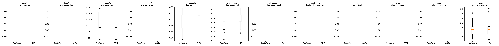

# FastWarp benchmark: recipe `cohort`

Machine and software of the latest `run` (`environment.json`):

- CPU: Intel(R) Core(TM) Ultra 7 258V, 8 logical cores, 8 physical
- GPU: Intel(R) Graphics (LNL), IntegratedGpu, Vulkan, driver name Intel open-source Mesa driver
- OS: Linux-6.17.0-1033-oem-x86_64-with-glibc2.39; Python 3.13.16, NumPy 2.3.5, SciPy 1.15.3
- fastwarp 0.2.0 (engine fastwarp-legacy 90c1df3); ANTs v2.5.1.post95-g2236a75 (ANTsPy's bundled antsRegistration); ANTsPy 0.6.3
- benchmark commit 124d690c55aa10dc01f5de26d360f02466992567, recorded 2026-11-17T21:15:02+00:00

Thread setting of each command (all cores unless `--threads` capped both engines; timings with different settings are not comparable, so the tables keep them apart):

- `run`: threads all cores (ANTs and FastWarp's CPU work); 8 logical, 8 physical cores
- `linear`: threads all cores (ANTs and FastWarp's CPU work); 8 logical, 8 physical cores
- `post`: threads all cores (ANTs and FastWarp's CPU work); 8 logical, 8 physical cores

## FastWarp against ANTs, paired over the same pairs

Difference = FastWarp minus ANTs; CI = 95 % percentile bootstrap of the mean difference; p = Wilcoxon signed-rank (pairs share subjects, so the p-values and CIs treat dependent pairs as independent).

| Dataset | Metric | Better | Pairs | FastWarp mean | SD | ANTs mean | SD | Mean diff. | CI low | CI high | p |
| --- | --- | --- | --- | --- | --- | --- | --- | --- | --- | --- | --- |
| deep7t | wall_s | lower | 10 | 7.747 | 0.482 | 366.002 | 45.739 | -358.255 | -385.203 | -331.837 | 0.002 |
| deep7t | jac_nonpositive_frac | lower | 10 | 0.000 | 0.000 | 0.000 | 0.000 | 0.000 | 0.000 | 0.000 | 1.000 |
| deep7t | dice_deep_nuclei | higher | 10 | 0.732 | 0.034 | 0.732 | 0.034 | 4.99e-05 | -2.01e-04 | 2.58e-04 | 0.492 |
| deep7t | hd95_mm_deep_nuclei | lower | 10 | 1.515 | 0.229 | 1.516 | 0.232 | -6.02e-04 | -0.004 | 0.003 | 0.625 |
| deep7t | assd_mm_deep_nuclei | lower | 10 | 0.543 | 0.066 | 0.543 | 0.066 | -7.96e-05 | -5.58e-04 | 4.50e-04 | 0.625 |
| mindboggle | wall_s | lower | 20 | 8.418 | 0.597 | 391.957 | 101.147 | -383.539 | -428.674 | -342.936 | 1.91e-06 |
| mindboggle | dice_cortical | higher | 20 | 0.567 | 0.014 | 0.567 | 0.014 | -1.15e-05 | -1.76e-04 | 1.57e-04 | 0.956 |
| mindboggle | hd95_mm_cortical | lower | 20 | 5.888 | 0.408 | 5.886 | 0.408 | 0.002 | -0.004 | 0.008 | 0.452 |
| mindboggle | assd_mm_cortical | lower | 20 | 1.302 | 0.077 | 1.303 | 0.078 | -4.11e-04 | -9.43e-04 | 1.23e-04 | 0.261 |
| mindboggle | dice_subcortical | higher | 20 | 0.798 | 0.018 | 0.798 | 0.018 | -4.43e-05 | -1.56e-04 | 8.16e-05 | 0.294 |
| mindboggle | hd95_mm_subcortical | lower | 20 | 1.945 | 0.355 | 1.944 | 0.354 | 0.001 | -0.002 | 0.004 | 0.600 |
| mindboggle | assd_mm_subcortical | lower | 20 | 0.725 | 0.075 | 0.724 | 0.076 | 1.40e-04 | -1.40e-04 | 3.84e-04 | 0.165 |
| mindboggle | jac_nonpositive_frac | lower | 20 | 0.000 | 0.000 | 0.000 | 0.000 | 0.000 | 0.000 | 0.000 | 1.000 |
| snsx | wall_s | lower | 20 | 19.618 | 0.391 | 595.480 | 5.197 | -575.862 | -578.121 | -573.894 | 1.91e-06 |
| snsx | jac_nonpositive_frac | lower | 20 | 0.000 | 0.000 | 0.000 | 0.000 | 0.000 | 0.000 | 0.000 | 1.000 |
| snsx | landmark_mean_mm | lower | 20 | 1.741 | 0.362 | 1.745 | 0.365 | -0.004 | -0.010 | 0.001 | 0.202 |
| snsx | landmark_median_mm | lower | 20 | 1.335 | 0.235 | 1.337 | 0.242 | -0.002 | -0.012 | 0.007 | 0.729 |

## Agreement between the two engines

Field differences (mm) inside the fixed brain mask; Dice between the label maps the two engines warp.

| Dataset | Metric | Pairs | Mean | SD | Max |
| --- | --- | --- | --- | --- | --- |
| deep7t | field_diff_rms_mm | 10 | 0.125 | 0.185 | 0.528 |
| deep7t | field_diff_mean_mm | 10 | 0.078 | 0.111 | 0.340 |
| deep7t | field_diff_p95_mm | 10 | 0.250 | 0.374 | 1.124 |
| deep7t | field_diff_max_mm | 10 | 1.459 | 2.317 | 6.643 |
| deep7t | agreement_dice_deep_nuclei | 10 | 0.997 | 0.003 | 1.000 |
| mindboggle | field_diff_rms_mm | 20 | 0.078 | 0.079 | 0.328 |
| mindboggle | field_diff_mean_mm | 20 | 0.041 | 0.034 | 0.132 |
| mindboggle | field_diff_p95_mm | 20 | 0.130 | 0.120 | 0.483 |
| mindboggle | field_diff_max_mm | 20 | 1.376 | 1.441 | 5.371 |
| mindboggle | agreement_dice_cortical | 20 | 0.987 | 0.010 | 0.999 |
| mindboggle | agreement_dice_subcortical | 20 | 0.998 | 0.002 | 1.000 |
| snsx | field_diff_rms_mm | 20 | 0.171 | 0.154 | 0.552 |
| snsx | field_diff_mean_mm | 20 | 0.132 | 0.117 | 0.422 |
| snsx | field_diff_p95_mm | 20 | 0.352 | 0.324 | 1.134 |
| snsx | field_diff_max_mm | 20 | 0.950 | 0.727 | 2.471 |

## Mean Dice per structure (non-cortical)

| Dataset | Label | Structure | FastWarp | ANTs | Pairs |
| --- | --- | --- | --- | --- | --- |
| deep7t | 1 | STN_L | 0.619 | 0.618 | 10 |
| deep7t | 2 | STN_R | 0.636 | 0.636 | 10 |
| deep7t | 3 | SN_L | 0.717 | 0.717 | 10 |
| deep7t | 4 | SN_R | 0.721 | 0.721 | 10 |
| deep7t | 5 | RN_L | 0.828 | 0.828 | 10 |
| deep7t | 6 | RN_R | 0.804 | 0.804 | 10 |
| deep7t | 7 | GPe_L | 0.789 | 0.789 | 10 |
| deep7t | 8 | GPe_R | 0.772 | 0.772 | 10 |
| deep7t | 9 | GPi_L | 0.714 | 0.714 | 10 |
| deep7t | 10 | GPi_R | 0.717 | 0.717 | 10 |
| mindboggle | 10 | Left-Thalamus | 0.875 | 0.875 | 20 |
| mindboggle | 11 | Left-Caudate | 0.797 | 0.796 | 20 |
| mindboggle | 12 | Left-Putamen | 0.870 | 0.870 | 20 |
| mindboggle | 13 | Left-Pallidum | 0.812 | 0.812 | 20 |
| mindboggle | 17 | Left-Hippocampus | 0.765 | 0.765 | 20 |
| mindboggle | 18 | Left-Amygdala | 0.717 | 0.717 | 20 |
| mindboggle | 26 | Left-Accumbens | 0.697 | 0.697 | 20 |
| mindboggle | 28 | Left-VentralDC | 0.839 | 0.840 | 20 |
| mindboggle | 49 | Right-Thalamus | 0.875 | 0.876 | 20 |
| mindboggle | 50 | Right-Caudate | 0.800 | 0.800 | 20 |
| mindboggle | 51 | Right-Putamen | 0.868 | 0.868 | 20 |
| mindboggle | 52 | Right-Pallidum | 0.821 | 0.821 | 20 |
| mindboggle | 53 | Right-Hippocampus | 0.768 | 0.769 | 20 |
| mindboggle | 54 | Right-Amygdala | 0.709 | 0.708 | 20 |
| mindboggle | 58 | Right-Accumbens | 0.708 | 0.708 | 20 |
| mindboggle | 60 | Right-VentralDC | 0.840 | 0.840 | 20 |

## Registration time

Seconds per registration, median (quartiles); `[n=k]`: only k registrations have the value. Linear: the rigid and affine stages; SyN: the SyN stage; total: the engine's own total (FastWarp: opening the GPU, resampling, preprocessing, both stages, warping the moving image onto the grid and writing the transforms; ANTs: `Total elapsed time`, the stages and their set-up without reading the images or writing the transforms), so the totals do not cover the same work; wall: FastWarp's `register_syn` call (images already read), ANTs' whole process (start, reading, writing; with ANTsPy also starting Python). ANTs' split comes from its `--verbose 1` log. ANTs / FastWarp: the median over pairs of the ratio, on the pairs where both engines have the value and ran on the same machine and software.

| Dataset | Grid | Threads | Engine | Registrations | Linear (s) | SyN (s) | Total (s) | Wall (s) |
| --- | --- | --- | --- | --- | --- | --- | --- | --- |
| deep7t | 1 mm | all cores | fastwarp | 10 | 2.3 (2.2–2.4) | 5.0 (4.8–5.2) | 7.8 (7.3–8.0) | 7.9 (7.3–8.1) |
| deep7t | 1 mm | all cores | ants | 10 | 15.8 (14.4–16.7) | 335.6 (323.4–370.9) | 350.7 (339.0–388.9) | 355.6 (343.9–394.4) |
| deep7t | 1 mm | all cores | ANTs / FastWarp |  | 6.8x (10 pairs) | 66.6x (10 pairs) | 46.4x (10 pairs) | 46.7x (10 pairs) |
| mindboggle | 1 mm | all cores | fastwarp | 20 | 2.6 (2.5–2.7) | 5.4 (5.2–5.5) | 8.4 (7.9–8.8) | 8.5 (8.0–8.8) |
| mindboggle | 1 mm | all cores | ants | 20 | 20.5 (18.7–33.0) | 326.2 (301.8–389.9) | 345.9 (322.2–425.6) | 352.3 (327.7–434.4) |
| mindboggle | 1 mm | all cores | ANTs / FastWarp |  | 7.5x (20 pairs) | 58.7x (20 pairs) | 40.0x (20 pairs) | 40.3x (20 pairs) |
| snsx | 1 mm | all cores | fastwarp | 20 | 2.9 (2.8–3.2) | 15.9 (15.8–16.0) | 19.5 (19.3–19.6) | 19.6 (19.4–19.7) |
| snsx | 1 mm | all cores | ants | 20 | 24.0 (21.7–24.8) | 561.1 (559.4–562.8) | 585.1 (581.8–586.9) | 595.2 (591.8–596.9) |
| snsx | 1 mm | all cores | ANTs / FastWarp |  | 7.9x (20 pairs) | 35.3x (20 pairs) | 30.0x (20 pairs) | 30.4x (20 pairs) |

## Linear fits

Seconds per fit, median (quartiles). FastWarp: one `linear_session` per pair; its preparation (opening the GPU, converting, winsorizing and uploading the images, the centre-of-mass start) is its own row and not part of the fits; rigid from the centres of mass, affine from the rigid result, then a rigid multi-start. ANTs: one `antsRegistration` stage time each, which includes the stage's own image preparation; no multi-start. Rigid + affine compares FastWarp's preparation and both fits with ANTs' two stages. Pairs: FastWarp / ANTs. ANTs / FastWarp: the median over pairs of the ratio (same machine and software). Landmark error: mean over the landmarks of a pair, mm; FastWarp - ANTs: mean and max distance between the two fits over the fixed brain mask, mm (the multi-start against ANTs' rigid fit).

| Dataset | Grid | Threads | Fit | Pairs | FastWarp (s) | ANTs (s) | ANTs / FastWarp | Landmarks FastWarp (mm) | Landmarks ANTs (mm) | FastWarp - ANTs mean (mm) | FastWarp - ANTs max (mm) |
| --- | --- | --- | --- | --- | --- | --- | --- | --- | --- | --- | --- |
| snsx | 1 mm | all cores | session preparation | 20 / 0 | 0.25 (0.25–0.26) | n/a | n/a | n/a | n/a | n/a | n/a |
| snsx | 1 mm | all cores | rigid + affine (FastWarp with its preparation) | 20 / 20 | 2.89 (2.72–3.00) | 23.85 (21.91–24.41) | 8.0x (20 pairs) | n/a | n/a | n/a | n/a |
| snsx | 1 mm | all cores | rigid | 20 / 20 | 1.45 (1.38–1.51) | 10.04 (8.96–10.72) | 6.7x (20 pairs) | 13.65 (9.71–17.02) | 13.95 (10.85–17.04) | 1.32 (0.78–2.30) | 2.36 (1.34–4.51) |
| snsx | 1 mm | all cores | affine (from the rigid fit) | 20 / 20 | 1.19 (1.10–1.26) | 13.43 (12.85–14.21) | 11.3x (20 pairs) | 2.91 (2.47–3.49) | 2.92 (2.47–3.46) | 0.17 (0.08–0.22) | 0.35 (0.19–0.46) |
| snsx | 1 mm | all cores | rigid multi-start | 20 / 0 | 3.13 (2.95–3.29) | n/a | n/a | 12.84 (9.91–16.95) | n/a | 3.48 (2.28–10.39) | 6.74 (3.90–21.42) |

## Post-processing

Seconds per step, median (quartiles), each including reading the inputs (read once, untimed, before both tools, so both find them cached) and writing the output; ANTs: `antsApplyTransforms --float 1`. `.nii`: uncompressed output; `.nii.gz`: FastWarp's fields gzip level 1 in parallel, ITK (ANTs' outputs and FastWarp's re-warped image) its default level on one thread. Size: median output MB, FastWarp / ANTs. ANTs / FastWarp: the median over pairs of the ratio. Difference (of the `.nii` outputs): median over pairs of the max field difference (mm) or of the relative RMS difference of the re-warped images.

| Dataset | Grid | Threads | Step | Output | Pairs | Voxels | ANTs (s) | FastWarp (s) | ANTs / FastWarp | Size (MB) | Difference |
| --- | --- | --- | --- | --- | --- | --- | --- | --- | --- | --- | --- |
| deep7t | 1 mm | all cores | forward field (compose) | .nii | 10 | 14.1 M | 0.52 (0.49–0.55) | 0.35 (0.34–0.38) | 1.5x (10 pairs) | 169 / 169 | max 2.61e-05 mm |
| deep7t | 1 mm | all cores | inverse field (compose) | .nii | 10 | 24.0 M | 0.70 (0.69–0.71) | 0.48 (0.47–0.50) | 1.5x (10 pairs) | 288 / 288 | max 3.92e-05 mm |
| deep7t | 1 mm | all cores | Lanczos re-warp | .nii | 10 | 14.1 M | 6.69 (6.21–7.19) | 0.90 (0.87–0.95) | 7.4x (10 pairs) | 56 / 56 | relative RMS 4.42e-06 |
| mindboggle | 1 mm | all cores | forward field (compose) | .nii | 20 | 4.7 M | 0.22 (0.21–0.23) | 0.13 (0.13–0.14) | 1.6x (20 pairs) | 56 / 56 | max 2.25e-05 mm |
| mindboggle | 1 mm | all cores | inverse field (compose) | .nii | 20 | 10.5 M | 0.34 (0.33–0.34) | 0.22 (0.22–0.23) | 1.5x (20 pairs) | 126 / 126 | max 3.03e-05 mm |
| mindboggle | 1 mm | all cores | Lanczos re-warp | .nii | 20 | 4.7 M | 2.26 (2.12–2.33) | 0.32 (0.31–0.33) | 6.9x (20 pairs) | 19 / 19 | relative RMS 1.70e-06 |
| snsx | 1 mm | all cores | forward field (compose) | .nii | 20 | 8.5 M | 0.46 (0.46–0.46) | 0.33 (0.33–0.34) | 1.4x (20 pairs) | 102 / 102 | max 2.83e-05 mm |
| snsx | 1 mm | all cores | inverse field (compose) | .nii | 20 | 26.2 M | 0.90 (0.90–0.91) | 0.64 (0.63–0.65) | 1.4x (20 pairs) | 314 / 314 | max 4.78e-05 mm |
| snsx | 1 mm | all cores | Lanczos re-warp | .nii | 20 | 8.5 M | 3.99 (3.85–4.02) | 0.78 (0.77–0.79) | 5.0x (20 pairs) | 34 / 34 | relative RMS 3.08e-06 |

