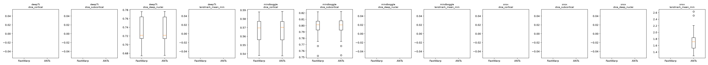

# FastWarp benchmark: recipe `cohort`

Machine and software of the latest `run` (`environment.json`):

- CPU: Intel64 Family 6 Model 79 Stepping 1, GenuineIntel, 48 logical cores, not recorded physical
- GPU: Quadro K620, DiscreteGpu, Vulkan, driver name ?
- OS: Windows-2022Server-10.0.20348-SP0; Python 3.13.18, NumPy 2.3.5, SciPy 1.15.3
- fastwarp 0.2.0 (engine fastwarp-legacy 90c1df3); ANTs v2.5.1.post95-g2236a75 (ANTsPy's bundled antsRegistration); ANTsPy 0.6.3
- benchmark commit 124d690c55aa10dc01f5de26d360f02466992567, recorded 2026-11-17T08:46:59+00:00

Thread setting of each command (all cores unless `--threads` capped both engines; timings with different settings are not comparable, so the tables keep them apart):

- `run`: threads all cores (ANTs and FastWarp's CPU work); 48 logical, not recorded physical cores
- `linear`: threads all cores (ANTs and FastWarp's CPU work); 48 logical, not recorded physical cores
- `post`: threads all cores (ANTs and FastWarp's CPU work); 48 logical, not recorded physical cores

## FastWarp against ANTs, paired over the same pairs

Difference = FastWarp minus ANTs; CI = 95 % percentile bootstrap of the mean difference; p = Wilcoxon signed-rank (pairs share subjects, so the p-values and CIs treat dependent pairs as independent).

| Dataset | Metric | Better | Pairs | FastWarp mean | SD | ANTs mean | SD | Mean diff. | CI low | CI high | p |
| --- | --- | --- | --- | --- | --- | --- | --- | --- | --- | --- | --- |
| deep7t | wall_s | lower | 10 | 31.421 | 2.264 | 421.524 | 42.626 | -390.103 | -414.258 | -365.408 | 0.002 |
| deep7t | jac_nonpositive_frac | lower | 10 | 0.000 | 0.000 | 0.000 | 0.000 | 0.000 | 0.000 | 0.000 | 1.000 |
| deep7t | dice_deep_nuclei | higher | 10 | 0.732 | 0.035 | 0.732 | 0.034 | -4.11e-05 | -3.17e-04 | 2.23e-04 | 0.846 |
| deep7t | hd95_mm_deep_nuclei | lower | 10 | 1.515 | 0.232 | 1.513 | 0.232 | 0.002 | -0.001 | 0.006 | 0.688 |
| deep7t | assd_mm_deep_nuclei | lower | 10 | 0.543 | 0.066 | 0.543 | 0.065 | -2.06e-04 | -9.25e-04 | 4.40e-04 | 0.846 |
| mindboggle | wall_s | lower | 20 | 36.919 | 2.801 | 377.857 | 24.907 | -340.938 | -350.253 | -331.112 | 1.91e-06 |
| mindboggle | dice_cortical | higher | 20 | 0.567 | 0.014 | 0.567 | 0.014 | -4.27e-06 | -2.52e-04 | 1.80e-04 | 0.409 |
| mindboggle | hd95_mm_cortical | lower | 20 | 5.890 | 0.410 | 5.886 | 0.408 | 0.004 | 4.85e-04 | 0.007 | 0.143 |
| mindboggle | assd_mm_cortical | lower | 20 | 1.303 | 0.078 | 1.303 | 0.078 | -1.99e-04 | -7.83e-04 | 4.51e-04 | 0.522 |
| mindboggle | dice_subcortical | higher | 20 | 0.798 | 0.018 | 0.798 | 0.018 | -3.50e-05 | -2.05e-04 | 1.27e-04 | 0.927 |
| mindboggle | hd95_mm_subcortical | lower | 20 | 1.942 | 0.356 | 1.946 | 0.353 | -0.005 | -0.008 | -8.09e-04 | 0.030 |
| mindboggle | assd_mm_subcortical | lower | 20 | 0.725 | 0.076 | 0.724 | 0.076 | 1.16e-04 | -3.20e-04 | 6.06e-04 | 0.812 |
| mindboggle | jac_nonpositive_frac | lower | 20 | 0.000 | 0.000 | 0.000 | 0.000 | 0.000 | 0.000 | 0.000 | 1.000 |

## Agreement between the two engines

Field differences (mm) inside the fixed brain mask; Dice between the label maps the two engines warp.

| Dataset | Metric | Pairs | Mean | SD | Max |
| --- | --- | --- | --- | --- | --- |
| deep7t | field_diff_rms_mm | 10 | 0.129 | 0.172 | 0.575 |
| deep7t | field_diff_mean_mm | 10 | 0.074 | 0.080 | 0.268 |
| deep7t | field_diff_p95_mm | 10 | 0.243 | 0.293 | 0.959 |
| deep7t | field_diff_max_mm | 10 | 1.514 | 2.224 | 7.527 |
| deep7t | agreement_dice_deep_nuclei | 10 | 0.997 | 0.002 | 0.999 |
| mindboggle | field_diff_rms_mm | 20 | 0.082 | 0.073 | 0.271 |
| mindboggle | field_diff_mean_mm | 20 | 0.045 | 0.040 | 0.152 |
| mindboggle | field_diff_p95_mm | 20 | 0.144 | 0.131 | 0.459 |
| mindboggle | field_diff_max_mm | 20 | 1.414 | 1.293 | 4.439 |
| mindboggle | agreement_dice_cortical | 20 | 0.986 | 0.012 | 0.998 |
| mindboggle | agreement_dice_subcortical | 20 | 0.997 | 0.002 | 1.000 |

## Mean Dice per structure (non-cortical)

| Dataset | Label | Structure | FastWarp | ANTs | Pairs |
| --- | --- | --- | --- | --- | --- |
| deep7t | 1 | STN_L | 0.618 | 0.617 | 10 |
| deep7t | 2 | STN_R | 0.636 | 0.637 | 10 |
| deep7t | 3 | SN_L | 0.717 | 0.717 | 10 |
| deep7t | 4 | SN_R | 0.721 | 0.721 | 10 |
| deep7t | 5 | RN_L | 0.828 | 0.827 | 10 |
| deep7t | 6 | RN_R | 0.804 | 0.804 | 10 |
| deep7t | 7 | GPe_L | 0.789 | 0.789 | 10 |
| deep7t | 8 | GPe_R | 0.772 | 0.772 | 10 |
| deep7t | 9 | GPi_L | 0.715 | 0.714 | 10 |
| deep7t | 10 | GPi_R | 0.716 | 0.717 | 10 |
| mindboggle | 10 | Left-Thalamus | 0.875 | 0.875 | 20 |
| mindboggle | 11 | Left-Caudate | 0.796 | 0.796 | 20 |
| mindboggle | 12 | Left-Putamen | 0.870 | 0.870 | 20 |
| mindboggle | 13 | Left-Pallidum | 0.812 | 0.812 | 20 |
| mindboggle | 17 | Left-Hippocampus | 0.765 | 0.765 | 20 |
| mindboggle | 18 | Left-Amygdala | 0.717 | 0.717 | 20 |
| mindboggle | 26 | Left-Accumbens | 0.697 | 0.697 | 20 |
| mindboggle | 28 | Left-VentralDC | 0.839 | 0.840 | 20 |
| mindboggle | 49 | Right-Thalamus | 0.876 | 0.876 | 20 |
| mindboggle | 50 | Right-Caudate | 0.800 | 0.800 | 20 |
| mindboggle | 51 | Right-Putamen | 0.868 | 0.868 | 20 |
| mindboggle | 52 | Right-Pallidum | 0.821 | 0.821 | 20 |
| mindboggle | 53 | Right-Hippocampus | 0.769 | 0.769 | 20 |
| mindboggle | 54 | Right-Amygdala | 0.709 | 0.708 | 20 |
| mindboggle | 58 | Right-Accumbens | 0.707 | 0.708 | 20 |
| mindboggle | 60 | Right-VentralDC | 0.840 | 0.840 | 20 |

## Registration time

Seconds per registration, median (quartiles); `[n=k]`: only k registrations have the value. Linear: the rigid and affine stages; SyN: the SyN stage; total: the engine's own total (FastWarp: opening the GPU, resampling, preprocessing, both stages, warping the moving image onto the grid and writing the transforms; ANTs: `Total elapsed time`, the stages and their set-up without reading the images or writing the transforms), so the totals do not cover the same work; wall: FastWarp's `register_syn` call (images already read), ANTs' whole process (start, reading, writing; with ANTsPy also starting Python). ANTs' split comes from its `--verbose 1` log. ANTs / FastWarp: the median over pairs of the ratio, on the pairs where both engines have the value and ran on the same machine and software.

| Dataset | Grid | Threads | Engine | Registrations | Linear (s) | SyN (s) | Total (s) | Wall (s) |
| --- | --- | --- | --- | --- | --- | --- | --- | --- |
| deep7t | 1 mm | all cores | fastwarp | 10 | 5.2 (4.9–5.4) | 25.1 (24.5–26.6) | 31.0 (30.1–32.7) | 31.2 (30.3–32.8) |
| deep7t | 1 mm | all cores | ants | 10 | 14.4 (13.1–15.4) | 386.8 (377.1–423.1) | 400.2 (392.4–438.5) | 411.6 (403.8–451.2) |
| deep7t | 1 mm | all cores | ANTs / FastWarp |  | 2.8x (10 pairs) | 15.2x (10 pairs) | 12.8x (10 pairs) | 13.1x (10 pairs) |
| mindboggle | 1 mm | all cores | fastwarp | 20 | 7.1 (6.8–7.3) | 29.4 (27.6–30.3) | 37.2 (35.5–38.5) | 37.4 (35.7–38.7) |
| mindboggle | 1 mm | all cores | ants | 20 | 16.1 (15.2–17.1) | 351.3 (339.0–368.9) | 367.3 (354.7–385.3) | 380.6 (367.5–398.4) |
| mindboggle | 1 mm | all cores | ANTs / FastWarp |  | 2.3x (20 pairs) | 12.1x (20 pairs) | 10.0x (20 pairs) | 10.3x (20 pairs) |
| snsx | 1 mm | all cores | ants | 20 | 20.7 (18.7–21.5) | 575.8 (574.6–576.2) | 596.4 (593.1–597.5) | 616.5 (613.3–617.7) |

## Linear fits

Seconds per fit, median (quartiles). FastWarp: one `linear_session` per pair; its preparation (opening the GPU, converting, winsorizing and uploading the images, the centre-of-mass start) is its own row and not part of the fits; rigid from the centres of mass, affine from the rigid result, then a rigid multi-start. ANTs: one `antsRegistration` stage time each, which includes the stage's own image preparation; no multi-start. Rigid + affine compares FastWarp's preparation and both fits with ANTs' two stages. Pairs: FastWarp / ANTs. ANTs / FastWarp: the median over pairs of the ratio (same machine and software). Landmark error: mean over the landmarks of a pair, mm; FastWarp - ANTs: mean and max distance between the two fits over the fixed brain mask, mm (the multi-start against ANTs' rigid fit).

| Dataset | Grid | Threads | Fit | Pairs | FastWarp (s) | ANTs (s) | ANTs / FastWarp | Landmarks FastWarp (mm) | Landmarks ANTs (mm) | FastWarp - ANTs mean (mm) | FastWarp - ANTs max (mm) |
| --- | --- | --- | --- | --- | --- | --- | --- | --- | --- | --- | --- |
| snsx | 1 mm | all cores | session preparation | 20 / 0 | 0.48 (0.47–0.49) | n/a | n/a | n/a | n/a | n/a | n/a |
| snsx | 1 mm | all cores | rigid + affine (FastWarp with its preparation) | 20 / 20 | 9.39 (8.90–9.61) | 19.70 (18.46–20.39) | 2.1x (20 pairs) | n/a | n/a | n/a | n/a |
| snsx | 1 mm | all cores | rigid | 20 / 20 | 5.12 (4.74–5.27) | 8.65 (8.02–9.12) | 1.8x (20 pairs) | 13.93 (10.24–17.37) | 14.48 (11.50–17.04) | 1.04 (0.49–2.41) | 2.07 (0.94–4.05) |
| snsx | 1 mm | all cores | affine (from the rigid fit) | 20 / 20 | 3.78 (3.54–3.94) | 11.20 (10.81–11.70) | 2.9x (20 pairs) | 2.95 (2.47–3.53) | 2.95 (2.47–3.53) | 0.15 (0.11–0.24) | 0.34 (0.23–0.48) |
| snsx | 1 mm | all cores | rigid multi-start | 20 / 0 | 7.80 (7.03–8.07) | n/a | n/a | 12.50 (9.99–16.68) | n/a | 6.11 (1.92–10.29) | 11.92 (3.87–19.10) |

## Post-processing

Seconds per step, median (quartiles), each including reading the inputs (read once, untimed, before both tools, so both find them cached) and writing the output; ANTs: `antsApplyTransforms --float 1`. `.nii`: uncompressed output; `.nii.gz`: FastWarp's fields gzip level 1 in parallel, ITK (ANTs' outputs and FastWarp's re-warped image) its default level on one thread. Size: median output MB, FastWarp / ANTs. ANTs / FastWarp: the median over pairs of the ratio. Difference (of the `.nii` outputs): median over pairs of the max field difference (mm) or of the relative RMS difference of the re-warped images.

| Dataset | Grid | Threads | Step | Output | Pairs | Voxels | ANTs (s) | FastWarp (s) | ANTs / FastWarp | Size (MB) | Difference |
| --- | --- | --- | --- | --- | --- | --- | --- | --- | --- | --- | --- |
| deep7t | 1 mm | all cores | forward field (compose) | .nii | 10 | 14.1 M | 0.85 (0.83–0.93) | 0.59 (0.57–0.63) | 1.5x (10 pairs) | 169 / 169 | max 2.59e-05 mm |
| deep7t | 1 mm | all cores | inverse field (compose) | .nii | 10 | 24.0 M | 4.03 (3.22–4.40) | 0.86 (0.85–0.86) | 4.7x (10 pairs) | 288 / 288 | max 3.67e-05 mm |
| deep7t | 1 mm | all cores | Lanczos re-warp | .nii | 10 | 14.1 M | 3.73 (3.57–3.99) | 0.89 (0.88–0.95) | 4.1x (10 pairs) | 56 / 56 | relative RMS 4.50e-06 |
| mindboggle | 1 mm | all cores | forward field (compose) | .nii | 20 | 4.7 M | 0.35 (0.34–0.37) | 0.25 (0.24–0.25) | 1.5x (20 pairs) | 56 / 56 | max 2.20e-05 mm |
| mindboggle | 1 mm | all cores | inverse field (compose) | .nii | 20 | 10.5 M | 0.62 (0.60–0.64) | 0.41 (0.40–0.42) | 1.5x (20 pairs) | 126 / 126 | max 3.22e-05 mm |
| mindboggle | 1 mm | all cores | Lanczos re-warp | .nii | 20 | 4.7 M | 1.40 (1.36–1.50) | 0.38 (0.36–0.40) | 3.8x (20 pairs) | 19 / 19 | relative RMS 1.70e-06 |
| snsx | 1 mm | all cores | forward field (compose) | .nii | 20 | 8.5 M | 1.56 (1.55–1.61) | 1.34 (1.34–1.37) | 1.2x (20 pairs) | 102 / 102 | max 2.73e-05 mm |
| snsx | 1 mm | all cores | inverse field (compose) | .nii | 20 | 26.2 M | 2.39 (2.36–2.44) | 1.92 (1.91–1.95) | 1.2x (20 pairs) | 314 / 314 | max 4.52e-05 mm |
| snsx | 1 mm | all cores | Lanczos re-warp | .nii | 20 | 8.5 M | 3.31 (3.23–3.38) | 1.74 (1.73–1.76) | 1.9x (20 pairs) | 34 / 34 | relative RMS 3.13e-06 |

