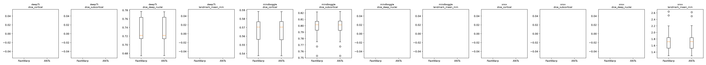

# FastWarp benchmark: recipe `cohort`

Machine and software of the latest `run` (`environment.json`):

- CPU: Intel(R) Xeon(R) Gold 6136 CPU @ 3.00GHz, 48 logical cores, 24 physical
- GPU: NVIDIA RTX A4000, DiscreteGpu, Vulkan, driver name NVIDIA
- OS: Linux-6.8.0-147-generic-x86_64-with-glibc2.39; Python 3.13.18, NumPy 2.3.5, SciPy 1.15.3
- fastwarp 0.2.0 (engine fastwarp-legacy 90c1df3); ANTs v2.5.1.post95-g2236a75 (ANTsPy's bundled antsRegistration); ANTsPy 0.6.3
- benchmark commit 124d690c55aa10dc01f5de26d360f02466992567, recorded 2026-11-17T21:00:07+00:00

Thread setting of each command (all cores unless `--threads` capped both engines; timings with different settings are not comparable, so the tables keep them apart):

- `run`: threads all cores (ANTs and FastWarp's CPU work); 48 logical, 24 physical cores
- `linear`: threads all cores (ANTs and FastWarp's CPU work); 48 logical, 24 physical cores
- `post`: threads all cores (ANTs and FastWarp's CPU work); 48 logical, 24 physical cores

## FastWarp against ANTs, paired over the same pairs

Difference = FastWarp minus ANTs; CI = 95 % percentile bootstrap of the mean difference; p = Wilcoxon signed-rank (pairs share subjects, so the p-values and CIs treat dependent pairs as independent).

| Dataset | Metric | Better | Pairs | FastWarp mean | SD | ANTs mean | SD | Mean diff. | CI low | CI high | p |
| --- | --- | --- | --- | --- | --- | --- | --- | --- | --- | --- | --- |
| deep7t | wall_s | lower | 10 | 4.430 | 0.253 | 249.436 | 29.408 | -245.006 | -262.476 | -227.995 | 0.002 |
| deep7t | jac_nonpositive_frac | lower | 10 | 0.000 | 0.000 | 0.000 | 0.000 | 0.000 | 0.000 | 0.000 | 1.000 |
| deep7t | dice_deep_nuclei | higher | 10 | 0.731 | 0.034 | 0.732 | 0.034 | -1.80e-04 | -3.98e-04 | 3.37e-05 | 0.193 |
| deep7t | hd95_mm_deep_nuclei | lower | 10 | 1.517 | 0.232 | 1.517 | 0.230 | 7.39e-04 | -0.004 | 0.005 | 0.812 |
| deep7t | assd_mm_deep_nuclei | lower | 10 | 0.543 | 0.066 | 0.543 | 0.065 | -2.36e-05 | -6.58e-04 | 5.02e-04 | 0.922 |
| mindboggle | wall_s | lower | 20 | 5.279 | 0.199 | 226.698 | 18.231 | -221.419 | -228.718 | -213.389 | 1.91e-06 |
| mindboggle | dice_cortical | higher | 20 | 0.567 | 0.014 | 0.567 | 0.014 | 5.17e-05 | -1.23e-04 | 2.32e-04 | 0.546 |
| mindboggle | hd95_mm_cortical | lower | 20 | 5.890 | 0.410 | 5.887 | 0.406 | 0.003 | -2.80e-04 | 0.006 | 0.154 |
| mindboggle | assd_mm_cortical | lower | 20 | 1.303 | 0.078 | 1.303 | 0.078 | 3.19e-05 | -5.38e-04 | 6.82e-04 | 0.674 |
| mindboggle | dice_subcortical | higher | 20 | 0.798 | 0.018 | 0.798 | 0.018 | 1.54e-05 | -1.48e-04 | 1.68e-04 | 0.430 |
| mindboggle | hd95_mm_subcortical | lower | 20 | 1.942 | 0.355 | 1.943 | 0.354 | -0.001 | -0.005 | 0.003 | 0.638 |
| mindboggle | assd_mm_subcortical | lower | 20 | 0.724 | 0.075 | 0.724 | 0.075 | -4.98e-05 | -3.53e-04 | 2.87e-04 | 0.522 |
| mindboggle | jac_nonpositive_frac | lower | 20 | 0.000 | 0.000 | 0.000 | 0.000 | 0.000 | 0.000 | 0.000 | 1.000 |
| snsx | wall_s | lower | 20 | 7.270 | 0.134 | 366.040 | 2.767 | -358.770 | -359.896 | -357.579 | 1.91e-06 |
| snsx | jac_nonpositive_frac | lower | 20 | 0.000 | 0.000 | 0.000 | 0.000 | 0.000 | 0.000 | 0.000 | 1.000 |
| snsx | landmark_mean_mm | lower | 20 | 1.749 | 0.370 | 1.748 | 0.367 | 0.001 | -0.005 | 0.007 | 0.498 |
| snsx | landmark_median_mm | lower | 20 | 1.348 | 0.244 | 1.342 | 0.248 | 0.006 | -0.004 | 0.016 | 0.368 |

## Agreement between the two engines

Field differences (mm) inside the fixed brain mask; Dice between the label maps the two engines warp.

| Dataset | Metric | Pairs | Mean | SD | Max |
| --- | --- | --- | --- | --- | --- |
| deep7t | field_diff_rms_mm | 10 | 0.182 | 0.374 | 1.206 |
| deep7t | field_diff_mean_mm | 10 | 0.092 | 0.160 | 0.511 |
| deep7t | field_diff_p95_mm | 10 | 0.310 | 0.587 | 1.877 |
| deep7t | field_diff_max_mm | 10 | 2.128 | 4.444 | 14.257 |
| deep7t | agreement_dice_deep_nuclei | 10 | 0.997 | 0.003 | 0.999 |
| mindboggle | field_diff_rms_mm | 20 | 0.069 | 0.046 | 0.150 |
| mindboggle | field_diff_mean_mm | 20 | 0.040 | 0.026 | 0.080 |
| mindboggle | field_diff_p95_mm | 20 | 0.128 | 0.087 | 0.284 |
| mindboggle | field_diff_max_mm | 20 | 1.126 | 0.733 | 2.529 |
| mindboggle | agreement_dice_cortical | 20 | 0.987 | 0.008 | 0.999 |
| mindboggle | agreement_dice_subcortical | 20 | 0.997 | 0.001 | 1.000 |
| snsx | field_diff_rms_mm | 20 | 0.162 | 0.169 | 0.763 |
| snsx | field_diff_mean_mm | 20 | 0.125 | 0.128 | 0.577 |
| snsx | field_diff_p95_mm | 20 | 0.328 | 0.345 | 1.556 |
| snsx | field_diff_max_mm | 20 | 0.963 | 0.948 | 4.037 |

## Mean Dice per structure (non-cortical)

| Dataset | Label | Structure | FastWarp | ANTs | Pairs |
| --- | --- | --- | --- | --- | --- |
| deep7t | 1 | STN_L | 0.618 | 0.619 | 10 |
| deep7t | 2 | STN_R | 0.635 | 0.636 | 10 |
| deep7t | 3 | SN_L | 0.716 | 0.717 | 10 |
| deep7t | 4 | SN_R | 0.721 | 0.721 | 10 |
| deep7t | 5 | RN_L | 0.828 | 0.828 | 10 |
| deep7t | 6 | RN_R | 0.804 | 0.804 | 10 |
| deep7t | 7 | GPe_L | 0.789 | 0.789 | 10 |
| deep7t | 8 | GPe_R | 0.772 | 0.772 | 10 |
| deep7t | 9 | GPi_L | 0.714 | 0.714 | 10 |
| deep7t | 10 | GPi_R | 0.717 | 0.717 | 10 |
| mindboggle | 10 | Left-Thalamus | 0.875 | 0.875 | 20 |
| mindboggle | 11 | Left-Caudate | 0.796 | 0.796 | 20 |
| mindboggle | 12 | Left-Putamen | 0.870 | 0.870 | 20 |
| mindboggle | 13 | Left-Pallidum | 0.812 | 0.812 | 20 |
| mindboggle | 17 | Left-Hippocampus | 0.765 | 0.765 | 20 |
| mindboggle | 18 | Left-Amygdala | 0.717 | 0.717 | 20 |
| mindboggle | 26 | Left-Accumbens | 0.697 | 0.697 | 20 |
| mindboggle | 28 | Left-VentralDC | 0.840 | 0.840 | 20 |
| mindboggle | 49 | Right-Thalamus | 0.875 | 0.876 | 20 |
| mindboggle | 50 | Right-Caudate | 0.800 | 0.800 | 20 |
| mindboggle | 51 | Right-Putamen | 0.868 | 0.868 | 20 |
| mindboggle | 52 | Right-Pallidum | 0.821 | 0.821 | 20 |
| mindboggle | 53 | Right-Hippocampus | 0.769 | 0.768 | 20 |
| mindboggle | 54 | Right-Amygdala | 0.709 | 0.708 | 20 |
| mindboggle | 58 | Right-Accumbens | 0.708 | 0.708 | 20 |
| mindboggle | 60 | Right-VentralDC | 0.840 | 0.840 | 20 |

## Registration time

Seconds per registration, median (quartiles); `[n=k]`: only k registrations have the value. Linear: the rigid and affine stages; SyN: the SyN stage; total: the engine's own total (FastWarp: opening the GPU, resampling, preprocessing, both stages, warping the moving image onto the grid and writing the transforms; ANTs: `Total elapsed time`, the stages and their set-up without reading the images or writing the transforms), so the totals do not cover the same work; wall: FastWarp's `register_syn` call (images already read), ANTs' whole process (start, reading, writing; with ANTsPy also starting Python). ANTs' split comes from its `--verbose 1` log. ANTs / FastWarp: the median over pairs of the ratio, on the pairs where both engines have the value and ran on the same machine and software.

| Dataset | Grid | Threads | Engine | Registrations | Linear (s) | SyN (s) | Total (s) | Wall (s) |
| --- | --- | --- | --- | --- | --- | --- | --- | --- |
| deep7t | 1 mm | all cores | fastwarp | 10 | 1.8 (1.8–1.9) | 1.7 (1.6–1.9) | 4.2 (4.1–4.5) | 4.4 (4.2–4.6) |
| deep7t | 1 mm | all cores | ants | 10 | 14.0 (13.3–14.1) | 221.4 (214.2–241.1) | 234.8 (228.1–255.9) | 242.5 (236.0–265.0) |
| deep7t | 1 mm | all cores | ANTs / FastWarp |  | 7.4x (10 pairs) | 128.1x (10 pairs) | 55.4x (10 pairs) | 55.6x (10 pairs) |
| mindboggle | 1 mm | all cores | fastwarp | 20 | 2.3 (2.2–2.4) | 2.0 (1.9–2.1) | 5.2 (5.0–5.2) | 5.3 (5.2–5.4) |
| mindboggle | 1 mm | all cores | ants | 20 | 14.5 (13.7–15.3) | 206.0 (199.2–211.1) | 220.8 (213.8–226.0) | 230.2 (222.6–239.1) |
| mindboggle | 1 mm | all cores | ANTs / FastWarp |  | 6.3x (20 pairs) | 101.9x (20 pairs) | 42.4x (20 pairs) | 42.8x (20 pairs) |
| snsx | 1 mm | all cores | fastwarp | 20 | 2.5 (2.5–2.6) | 3.3 (3.3–3.4) | 7.1 (7.0–7.1) | 7.3 (7.2–7.3) |
| snsx | 1 mm | all cores | ants | 20 | 18.8 (18.0–19.6) | 331.4 (329.9–334.0) | 350.2 (348.6–352.7) | 365.8 (364.4–368.4) |
| snsx | 1 mm | all cores | ANTs / FastWarp |  | 7.3x (20 pairs) | 99.2x (20 pairs) | 49.5x (20 pairs) | 50.2x (20 pairs) |

## Linear fits

Seconds per fit, median (quartiles). FastWarp: one `linear_session` per pair; its preparation (opening the GPU, converting, winsorizing and uploading the images, the centre-of-mass start) is its own row and not part of the fits; rigid from the centres of mass, affine from the rigid result, then a rigid multi-start. ANTs: one `antsRegistration` stage time each, which includes the stage's own image preparation; no multi-start. Rigid + affine compares FastWarp's preparation and both fits with ANTs' two stages. Pairs: FastWarp / ANTs. ANTs / FastWarp: the median over pairs of the ratio (same machine and software). Landmark error: mean over the landmarks of a pair, mm; FastWarp - ANTs: mean and max distance between the two fits over the fixed brain mask, mm (the multi-start against ANTs' rigid fit).

| Dataset | Grid | Threads | Fit | Pairs | FastWarp (s) | ANTs (s) | ANTs / FastWarp | Landmarks FastWarp (mm) | Landmarks ANTs (mm) | FastWarp - ANTs mean (mm) | FastWarp - ANTs max (mm) |
| --- | --- | --- | --- | --- | --- | --- | --- | --- | --- | --- | --- |
| snsx | 1 mm | all cores | session preparation | 20 / 0 | 0.57 (0.56–0.57) | n/a | n/a | n/a | n/a | n/a | n/a |
| snsx | 1 mm | all cores | rigid + affine (FastWarp with its preparation) | 20 / 20 | 3.07 (3.00–3.14) | 19.15 (18.07–19.97) | 6.1x (20 pairs) | n/a | n/a | n/a | n/a |
| snsx | 1 mm | all cores | rigid | 20 / 20 | 1.47 (1.42–1.52) | 6.47 (6.11–6.74) | 4.3x (20 pairs) | 14.43 (9.03–17.32) | 14.47 (10.78–17.04) | 1.15 (0.85–3.65) | 2.38 (1.49–5.76) |
| snsx | 1 mm | all cores | affine (from the rigid fit) | 20 / 20 | 1.05 (0.99–1.07) | 13.10 (11.78–13.52) | 12.5x (20 pairs) | 2.94 (2.47–3.50) | 2.94 (2.46–3.52) | 0.14 (0.10–0.29) | 0.31 (0.20–0.56) |
| snsx | 1 mm | all cores | rigid multi-start | 20 / 0 | 3.02 (2.96–3.15) | n/a | n/a | 12.87 (9.93–16.76) | n/a | 3.18 (1.95–8.92) | 5.92 (4.08–15.73) |

## Post-processing

Seconds per step, median (quartiles), each including reading the inputs (read once, untimed, before both tools, so both find them cached) and writing the output; ANTs: `antsApplyTransforms --float 1`. `.nii`: uncompressed output; `.nii.gz`: FastWarp's fields gzip level 1 in parallel, ITK (ANTs' outputs and FastWarp's re-warped image) its default level on one thread. Size: median output MB, FastWarp / ANTs. ANTs / FastWarp: the median over pairs of the ratio. Difference (of the `.nii` outputs): median over pairs of the max field difference (mm) or of the relative RMS difference of the re-warped images.

| Dataset | Grid | Threads | Step | Output | Pairs | Voxels | ANTs (s) | FastWarp (s) | ANTs / FastWarp | Size (MB) | Difference |
| --- | --- | --- | --- | --- | --- | --- | --- | --- | --- | --- | --- |
| deep7t | 1 mm | all cores | forward field (compose) | .nii | 10 | 14.1 M | 0.86 (0.81–0.94) | 0.57 (0.55–0.61) | 1.5x (10 pairs) | 169 / 169 | max 2.67e-05 mm |
| deep7t | 1 mm | all cores | inverse field (compose) | .nii | 10 | 24.0 M | 1.30 (1.25–1.31) | 0.84 (0.84–0.86) | 1.5x (10 pairs) | 288 / 288 | max 3.52e-05 mm |
| deep7t | 1 mm | all cores | Lanczos re-warp | .nii | 10 | 14.1 M | 2.54 (2.45–2.63) | 1.11 (1.09–1.16) | 2.3x (10 pairs) | 56 / 56 | relative RMS 4.38e-06 |
| mindboggle | 1 mm | all cores | forward field (compose) | .nii | 20 | 4.7 M | 0.38 (0.37–0.41) | 0.23 (0.23–0.25) | 1.6x (20 pairs) | 56 / 56 | max 2.22e-05 mm |
| mindboggle | 1 mm | all cores | inverse field (compose) | .nii | 20 | 10.5 M | 0.62 (0.60–0.64) | 0.40 (0.40–0.41) | 1.5x (20 pairs) | 126 / 126 | max 3.08e-05 mm |
| mindboggle | 1 mm | all cores | Lanczos re-warp | .nii | 20 | 4.7 M | 1.01 (0.99–1.10) | 0.44 (0.40–0.45) | 2.4x (20 pairs) | 19 / 19 | relative RMS 1.70e-06 |
| snsx | 1 mm | all cores | forward field (compose) | .nii | 20 | 8.5 M | 0.81 (0.79–0.92) | 0.57 (0.56–0.58) | 1.4x (20 pairs) | 102 / 102 | max 2.70e-05 mm |
| snsx | 1 mm | all cores | inverse field (compose) | .nii | 20 | 26.2 M | 1.48 (1.47–1.52) | 1.10 (1.09–1.11) | 1.4x (20 pairs) | 314 / 314 | max 4.92e-05 mm |
| snsx | 1 mm | all cores | Lanczos re-warp | .nii | 20 | 8.5 M | 1.92 (1.83–2.04) | 1.10 (1.09–1.11) | 1.8x (20 pairs) | 34 / 34 | relative RMS 3.02e-06 |

