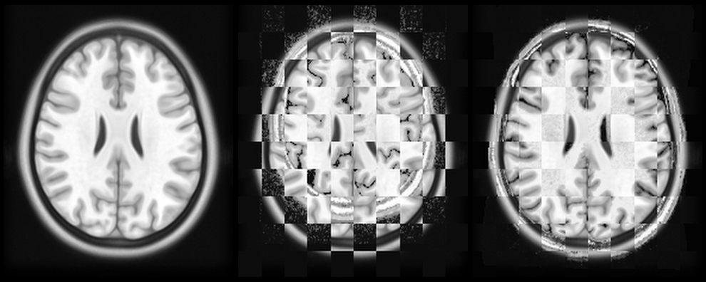

# FastWarp

**FastWarp registers 3-D images on the GPU.** It runs the rigid, affine and {term}`SyN`
registration of [ANTs](https://github.com/ANTsX/ANTs) on a graphics card and writes the same
transform files as ANTs, so the rest of an ANTs-based pipeline can stay as it is.

FastWarp is a Python package with a compiled Rust engine. It is meant for people who build or run
neuroimaging pipelines, for example to normalize brain MRI onto a template, and who use ANTs for
that today.

```{raw} html
<figure class="fw-hero">
  
  <figcaption><span>Template (fixed image)</span><span>Before: template and subject in a checkerboard</span><span>After FastWarp</span></figcaption>
</figure>
```

A 7 T scan of one subject of the public [SNSX dataset](https://openneuro.org/datasets/ds004470)
registered onto the MNI 2009c template with the default settings
([how the figure is made](guide/normalization.md#the-figure-on-the-home-page)).

::::{grid} 1 1 2 2
:gutter: 3

:::{grid-item-card} What it does
:class-card: sd-shadow-none

- A full normalization in one call: {term}`centre of mass`, Rigid, Affine, then SyN.
- Rigid or affine fits of one image pair, several in a row on images prepared once.
- Resampling and field composition like ANTs' `antsApplyTransforms`, on the CPU.
:::

:::{grid-item-card} What it works with
:class-card: sd-shadow-none

- GPUs through [wgpu](https://wgpu.rs): Vulkan (Linux, Windows), Metal (macOS) and DirectX 12
  (Windows).
- Python 3.11 or later and NumPy 2.0 or later. [ANTsPy](https://github.com/ANTsX/ANTsPy) is
  optional.
- Transform files that ANTs and ANTsPy read, such as `Composite.h5`.
:::
::::

```python
import ants
import fastwarp

fixed = ants.image_read(ants.get_ants_data("mni"))
moving = ants.image_read(ants.get_ants_data("ch2"))

info = fastwarp.register_syn(fixed, moving, "out/ch2_to_mni_")
warped = ants.apply_transforms(fixed, moving, ["out/ch2_to_mni_Composite.h5"])
```

## Where to go next

::::{grid} 1 2 3 3
:gutter: 3

:::{grid-item-card} {fas}`download` Installation
:link: installation
:link-type: doc

Install the wheel from PyPI, check that FastWarp finds your GPU, or build from source.
:::

:::{grid-item-card} {fas}`play` Quickstart
:link: quickstart
:link-type: doc

Register one brain image onto a template with public sample data.
:::

:::{grid-item-card} {fas}`book-open` User guide
:link: user-guide
:link-type: doc

How it works, images, output files, recipes, linear fits, resampling and GPU memory.
:::

:::{grid-item-card} {fas}`code` API reference
:link: api
:link-type: doc

Every public function, class, constant and exception, with its parameters.
:::

:::{grid-item-card} {fas}`gauge-high` Performance and validation
:link: validation
:link-type: doc

How speed and accuracy are measured against ANTs, and what the tests check today.
:::

:::{grid-item-card} {fas}`life-ring` Troubleshooting
:link: troubleshooting
:link-type: doc

No GPU found, too little GPU memory, and why results differ slightly from ANTs.
:::
::::

FastWarp is research software, licensed under the [Apache License 2.0](licence.md) and
maintained by Richard Köhler and Jan Philipp Payonk. If you use it in your work, please
[cite it](citing.md).

```{toctree}
:hidden:

getting-started
user-guide
reference
validation
project
```
